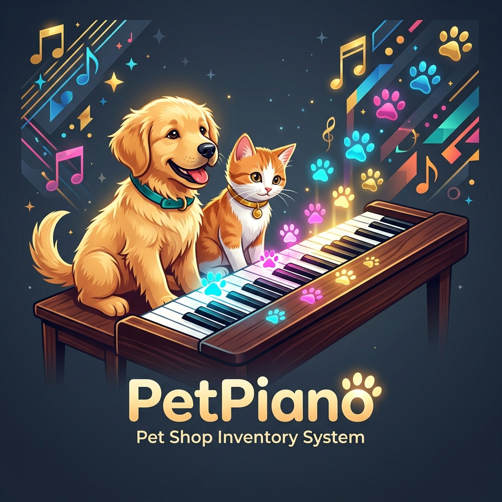
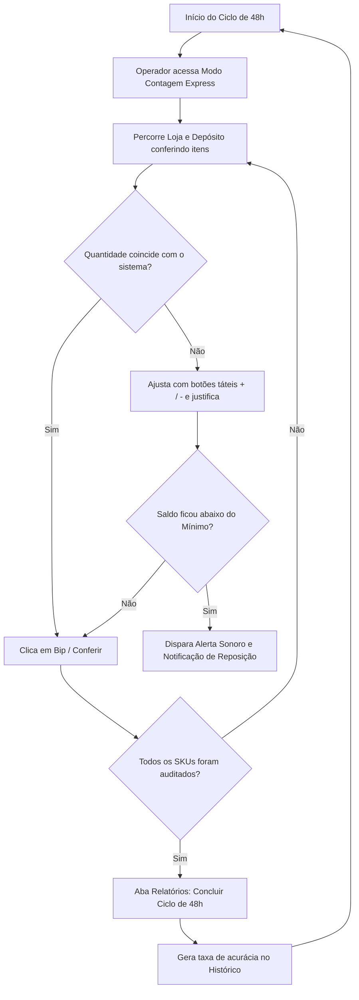

# 🎹 PetPiano — Sistema de Organização e Contagem de Mercadorias

<p align="center">
  
</p>

<p align="center">
  <strong>Gestão inteligente de gôndola e depósito com rotina ágil de contagem física a cada 2 dias (48h), alertas automáticos de ruptura e previsão de entregas de fornecedores.</strong>
</p>

<p align="center">
  <a href="#-sobre-o-projeto">Sobre</a> •
  <a href="#-principais-funcionalidades">Funcionalidades</a> •
  <a href="#-tecnologias-utilizadas">Tecnologias</a> •
  <a href="#-como-executar">Como Executar</a> •
  <a href="#-guia-do-ciclo-de-48-horas">Rotina de Contagem</a> •
  <a href="#-estrutura-do-projeto">Estrutura</a> •
  <a href="#-licença">Licença</a>
</p>

<p align="center">
  
  
  
  
  
</p>

---

## 📌 Sobre o Projeto

O **PetPiano** é uma solução web desenvolvida sob medida para a operação diária de um pet shop. O desafio comum desse segmento é o descompasso entre o que está exposto na frente de loja (gôndolas e prateleiras) e o que está guardado no depósito/almoxarifado, além da dificuldade de manter um inventário rotativo frequente sem paralisar o atendimento.

Com o **PetPiano**, a equipe realiza a contagem física **a cada 2 dias (ciclo de 48 horas)** de forma ultrarrápida (inclusive pelo celular ou tablet), mantendo o saldo sempre auditado, prevenindo quebras, calculando divergências e monitorando previsões de entrega de fornecedores para nunca faltar rações, medicamentos ou produtos essenciais.

---

## ✨ Principais Funcionalidades

### ⏱️ 1. Ciclo de Contagem de 2 Dias (48 Horas)
- **Timer Regressivo em Tempo Real**: Alerta no topo sobre o prazo de validade da rodada vigente.
- **Barra de Progresso do Inventário**: Monitora a porcentagem e quantidade de itens conferidos vs. pendentes.
- **Cálculo Imediato de Divergências**: Identifica diferenças numéricas em relação ao saldo contábil anterior (ex: `-2` por perda/avaria ou `+1` por sobra).
- **Encerramento de Ciclo & Auditoria**: Salva um histórico permanente com a taxa de acurácia percentual do estoque e abre um novo ciclo zerado para os próximos 2 dias.

### 🏪 2. Gestão Bipolar: Loja (Gôndola) vs. Estoque (Depósito)
- **Modo Contagem Express**: Cards táteis com botões rápidos (`+1`, `+5`, `+10`, `-1`) e campos numéricos diretos para contar na palma da mão.
- **Botão "Bip / Conferir"**: Carimbo imediato de data/hora da última conferência do operador com feedback musical.
- **Transferência Ágil (Depósito ➡️ Loja)**: Modal dedicado para transferir produtos do estoque para reposição de gôndola em 1 clique.

### 🚨 3. Alertas de Ruptura & Estoque Mínimo
- **Ponto de Alerta Parametrizável**: Configure o estoque mínimo de cada produto de acordo com o giro de vendas.
- **Central de Alertas em Tempo Real**: Separação visual entre itens normais, em ponto de atenção e com estoque crítico/zerado.
- **Notificações do Navegador (Web Notifications API)**: Notificações de desktop do sistema operacional ao atingir níveis críticos de segurança.

### 🚚 4. Previsão de Entregas & Gestão de Fornecedores
- **Rastreamento de Pedidos em Trânsito**: Acompanhe o número do pedido, quantidade encomendada e data estimada de chegada com contagem regressiva de dias.
- **Entrada Automática de Mercadorias**: Botão *"Confirmar Recebimento"* que credita instantaneamente a remessa entregue no estoque do produto.
- **Sugestão Inteligente de Reposição**: Se o item está com estoque baixo e sem pedido cadastrado, o sistema calcula a quantidade ideal com base no *lead time* do fornecedor.

### 🎹 5. Feedback Sonoro de Piano (Web Audio API)
- Efeitos sonoros sutis e agradáveis sintetizados diretamente pelo navegador (sem dependências pesadas):
  - 🎵 **Notas de incremento/decremento**: Confirmação sonora de ajuste.
  - 🎶 **Acorde Dó-Sol**: Item conferido com sucesso.
  - 🎹 **Acorde Triunfante (Dó Maior)**: Fechamento de ciclo de 48h ou recebimento de entrega.
  - 🔔 **Alerta harmônico**: Aviso sonoro discreto de estoque crítico.
  - Opção de silenciar (`Mute`) disponível a qualquer momento no cabeçalho.

### 📑 6. Exportação & Modo Prancheta (Impressão)
- **Exportação CSV**: Download com 1 clique de planilha com todos os saldos e status.
- **Impressão Otimizada**: Folha de contagem limpa em estilo A4 preto e branco para quem prefere prancheta física.

---

## 🛠️ Tecnologias Utilizadas

Este projeto foi construído utilizando padrões modernos de desenvolvimento web:

| Tecnologia | Finalidade |
| :--- | :--- |
| **HTML5 Semântico** | Estruturação acessível, uso de modais nativos `<dialog>` e landmarks. |
| **Vanilla CSS Moderno** | Design System completo com variáveis CSS, Glassmorphism, Dark Theme e responsividade mobile. |
| **JavaScript (ES6+)** | Lógica reativa modular, Web Audio API, Web Notifications e persistência local. |
| **Vite** | Bundler e servidor de desenvolvimento ultrarrápido com Hot Module Replacement (HMR). |
| **Web Storage (LocalStorage)** | Armazenamento de produtos, histórico de ciclos e entregas offline no navegador. |

---

## 🚀 Como Executar Localmente

### Pré-requisitos
- [Node.js](https://nodejs.org/) versão 18 ou superior instalado.
- Gerenciador de pacotes `npm` (já incluso no Node.js).

### Passo a Passo

1. **Clone o repositório:**
   ```bash
   git clone https://github.com/SEU_USUARIO/PetPiano.git
   cd PetPiano
   ```

2. **Instale as dependências:**
   ```bash
   npm install
   ```

3. **Inicie o servidor de desenvolvimento:**
   ```bash
   npm run dev
   ```

4. **Acesse no seu navegador:**
   ```
   http://localhost:5173/
   ```

### Scripts Disponíveis

- `npm run dev` — Inicia o servidor local de desenvolvimento com recarregamento em tempo real.
- `npm run build` — Gera os arquivos otimizados e minificados para produção na pasta `dist/`.
- `npm run preview` — Pré-visualiza localmente a versão final gerada pelo build de produção.

---

## 📋 Guia do Ciclo de 48 Horas (Rotina do Pet Shop)



1. **Dia 1 e 2:** A equipe utiliza a aba **"Contagem Rápida (2 Dias)"** em um smartphone ou tablet enquanto organiza as prateleiras.
2. **Atualização Imediata:** Cada produto recebe clique nos botões `+1`, `+5` ou entrada manual para a frente de loja e para o depósito.
3. **Identificação de Reposição:** Caso a loja esteja vazia mas o depósito tenha unidades, o botão *"Repor Loja"* realiza a transferência imediata.
4. **Fechamento do Ciclo:** Ao atingir 100% de conferência (ou ao término das 48h), a gerência clica em **"Concluir Ciclo & Registrar Histórico"**, arquivando a auditoria e abrindo a nova rodada.

---

## 📁 Estrutura do Projeto

```text
PetPiano/
├── dist/                 # Build de produção gerado pelo Vite
├── index.html            # Estrutura HTML da aplicação (Single Page)
├── styles.css            # Estilos CSS modernos (Dark Glassmorphism)
├── app.js                # Lógica do inventário, Web Audio e ciclo de 48h
├── petpiano_logo.jpg     # Identidade visual e logo do PetPiano
├── package.json          # Configuração de scripts e dependências Vite
└── README.md             # Documentação oficial do repositório
```

---

## 🔒 Armazenamento & Privacidade

- Todos os dados de mercadorias, fornecedores, histórico e preferências são armazenados localmente no navegador via `LocalStorage`.
- O sistema funciona de forma independente e não envia dados sensíveis para servidores externos.
- É possível exportar a qualquer momento os relatórios em `.csv` ou restaurar os dados de demonstração através do botão na aba de relatórios.

---

## 📄 Licença

Este projeto está sob a licença **MIT**. Veja o arquivo [LICENSE](LICENSE) para mais detalhes.

---

<p align="center">
  Desenvolvido com carinho para o <strong>PetPiano 🐾🎹</strong>
</p>
